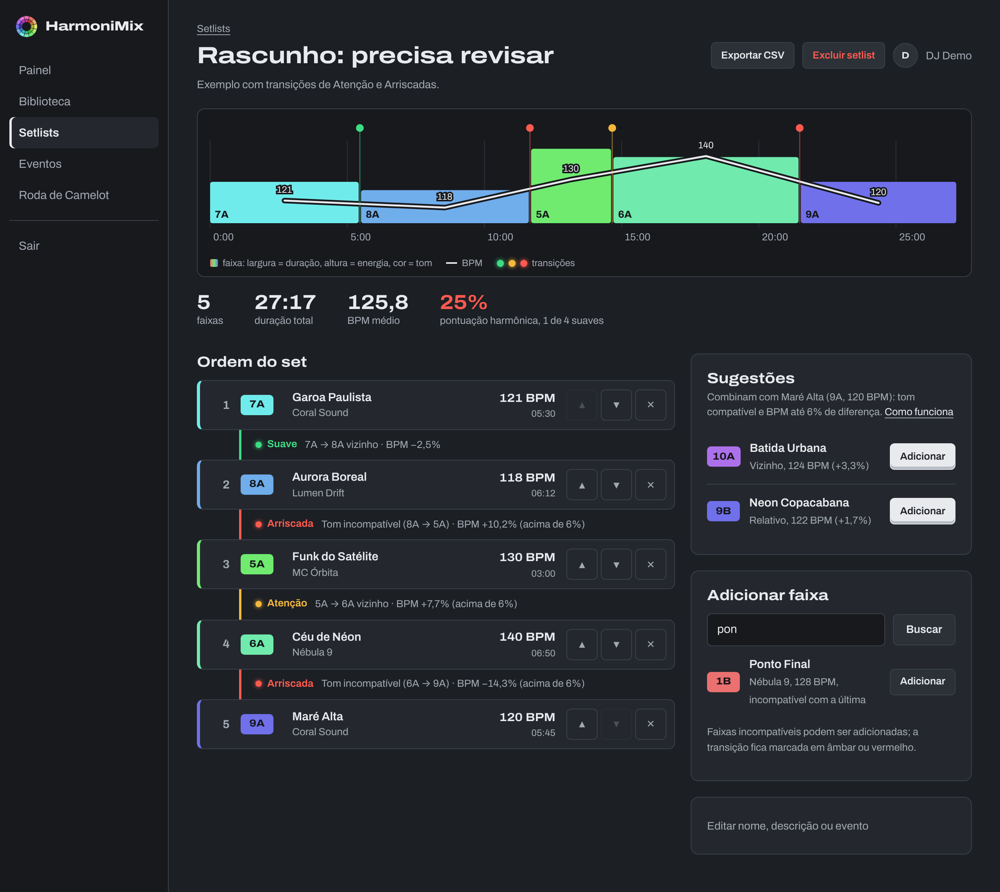

# 🎧 HarmoniMix

**Montador de setlists com mixagem harmônica para DJs.**

O DJ cadastra a sua biblioteca de músicas com **BPM** e **tom** (Roda de Camelot), monta setlists e o sistema:
- **sugere a próxima faixa** compatível;
- classifica cada transição como 🟢 **Suave**, 🟡 **Atenção** ou 🔴 **Arriscada**;
- mostra a **curva de energia** e a duração total do set.

> Projeto Integrador Transdisciplinar em Engenharia de Software II



## 📂 Organização do repositório

| Pasta | Conteúdo | Status |
|-------|----------|--------|
| [`situacao-1-planejamento/`](situacao-1-planejamento/) | Escopo, requisitos, UML, IHC e protótipo, banco de dados (conceitual, lógico, físico) e dicionário de dados | ✅ v2.0 |
| [`situacao-2-desenvolvimento/`](situacao-2-desenvolvimento/) | Código-fonte (front-end + back-end MVC), 217 testes (99% de cobertura), manual de uso, roteiro do vídeo | ✅ |
| [`situacao-3-validacao/`](situacao-3-validacao/) | Plano de testes (Modelo V), 15 testes de sistema no navegador, verificação e rastreabilidade, formulário para 5 testadores, registro de correções | ✅ testes · ⏳ testadores |

## ✅ Qualidade

| Nível de teste | Testes | Resultado |
|----------------|:------:|:---------:|
| Unitário | 152 | ✅ |
| Integração e segurança (SQLite e MariaDB) | 65 | ✅ |
| Sistema (navegador real, Playwright) | 15 | ✅ |
| Aceitação (5 usuários) | — | ⏳ |

Cobertura de código: **99%** · Defeitos encontrados e corrigidos: **7** ([registro](situacao-3-validacao/correcoes/REGISTRO-DE-CORRECOES.md))

## 🎬 Vídeos

- Demonstração: *(link)*
- Mudanças adotadas após os testes: *(link)*

## 🛠️ Tecnologias

| Camada | Tecnologia |
|--------|------------|
| Front-end | HTML5, CSS3, JavaScript (gráficos em SVG, sem bibliotecas externas) |
| Back-end | Python 3 + Flask (padrão **MVC**) |
| Banco de dados | **MySQL 8** (SQLite nos testes) |
| ORM | SQLAlchemy |
| Testes | pytest + pytest-cov |

## ▶️ Rodar o sistema (início rápido)

```bash
cd situacao-2-desenvolvimento
pip install -r requirements.txt
flask --app run init-db
flask --app run seed-demo
flask --app run run --debug
```

Acesse http://127.0.0.1:5000. Instruções completas em [situacao-2-desenvolvimento/README.md](situacao-2-desenvolvimento/README.md)
e no [manual de uso](situacao-2-desenvolvimento/docs/MANUAL-DE-USO.md).

## 🗄️ Banco de dados MySQL

```bash
mysql -u root -p < situacao-1-planejamento/sql/01_schema_mysql.sql
mysql -u root -p < situacao-1-planejamento/sql/02_dados_iniciais.sql
```

Usuário de demonstração: `demo@harmonimix.dev` / `Demo1234`

## 🎡 O que é a Roda de Camelot?

Um sistema que codifica as 24 tonalidades musicais em códigos de **1A a 12B**. Faixas com o **mesmo código**, com
**números vizinhos** (8A → 7A/9A) ou com o **mesmo número** (8A ↔ 8B) combinam harmonicamente.
