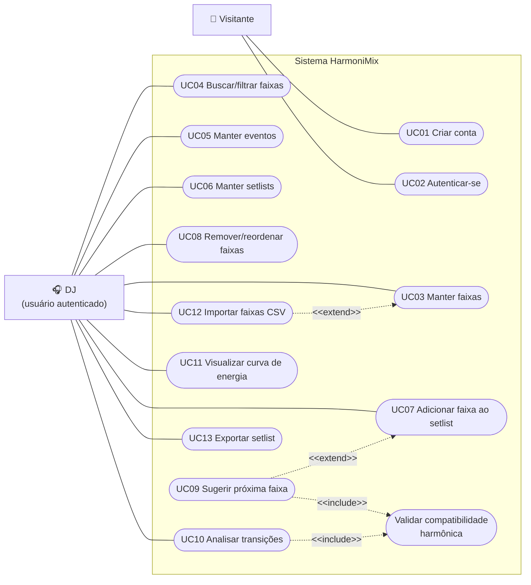
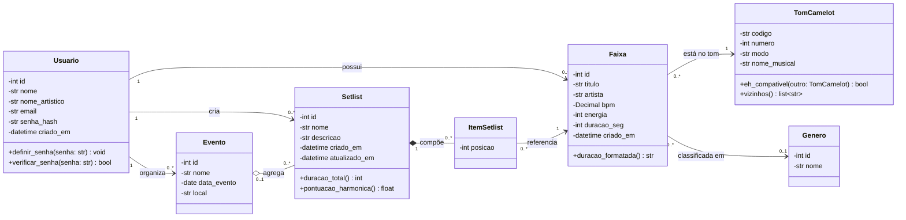
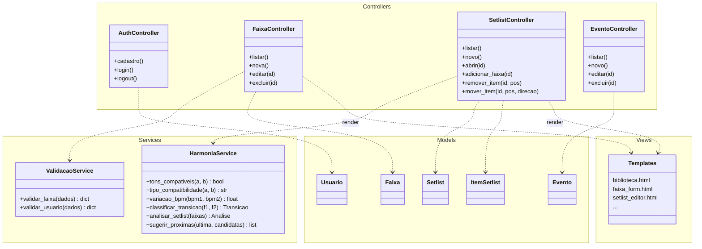
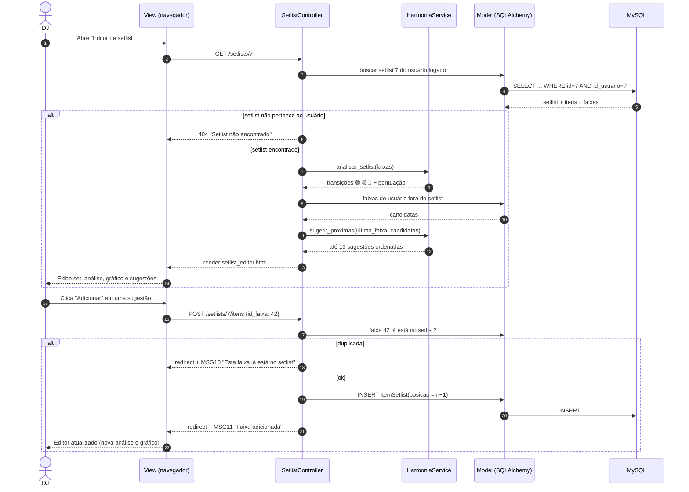
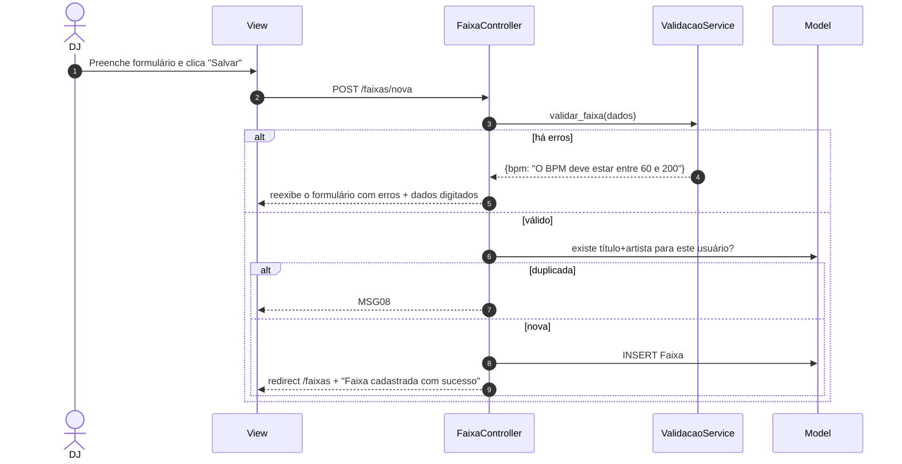
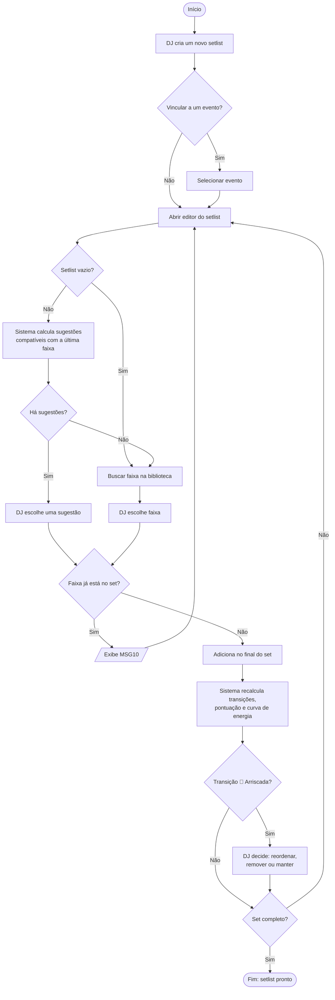
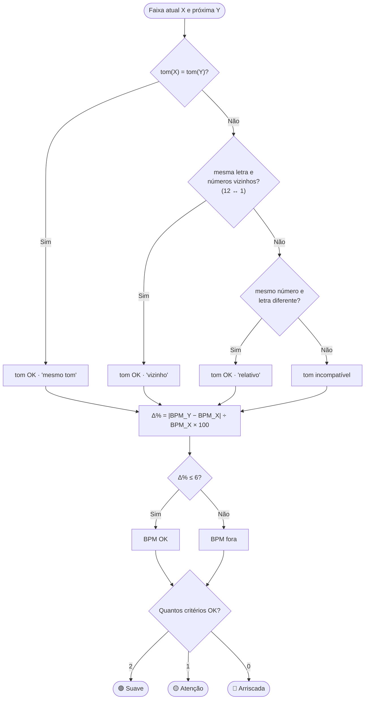

# 3. Modelagem UML: HarmoniMix

> Os diagramas estão em **Mermaid**, formato que o GitHub desenha automaticamente ao abrir este arquivo.
> Documento de Planejamento: versão 2.0.

---

## 3.1 Diagrama de Casos de Uso

> O Mermaid não tem uma notação própria de casos de uso. Por isso usamos a convenção: **atores** à esquerda,
> **casos de uso** em formato oval dentro da fronteira do sistema, e setas `<<include>>` e `<<extend>>` pontilhadas.

**Herança de atores:** o *DJ* é um *Visitante* que já se autenticou. Todos os casos de uso do DJ exigem o UC02.

### 3.1.1 Descrição dos principais casos de uso

#### UC03: Manter faixas
| Item | Descrição |
|------|-----------|
| **Ator** | DJ |
| **Pré-condição** | Usuário autenticado |
| **Fluxo principal** | 1. O DJ acessa **Biblioteca** → **Nova faixa**. 2. O sistema exibe o formulário (título, artista, BPM, tom, gênero, energia, duração mm:ss). 3. O DJ preenche e salva. 4. O sistema valida (RN02–RN05), grava e exibe "Faixa cadastrada com sucesso". |
| **Fluxos alternativos** | **A1. Editar:** o DJ escolhe uma faixa → *Editar* → altera → salva. **A2. Excluir:** o DJ escolhe *Excluir* → o sistema pede confirmação → exclui. |
| **Exceções** | **E1.** Dados inválidos → o formulário é reexibido com os dados digitados e a mensagem ao lado do campo (MSG03–MSG07). **E2.** Faixa duplicada → MSG08. **E3.** Faixa usada em setlist → exclusão bloqueada, com a lista dos setlists (MSG09). |
| **Pós-condição** | Faixa gravada, alterada ou excluída da biblioteca do DJ |

#### UC07: Adicionar faixa ao setlist (com extensão UC09: Sugerir próxima faixa)
| Item | Descrição |
|------|-----------|
| **Ator** | DJ |
| **Pré-condição** | Usuário autenticado; setlist existente; ao menos uma faixa cadastrada |
| **Fluxo principal** | 1. O DJ abre o **Editor de setlist**. 2. O sistema exibe as faixas do set, a análise das transições e o painel **Sugestões**. 3. O DJ escolhe uma faixa (pela busca ou pelas sugestões) → **Adicionar**. 4. O sistema verifica a duplicidade (RN10), insere a faixa na última posição e recalcula a análise, a pontuação e o gráfico. |
| **Extensão (UC09)** | No passo 2, se o setlist já tiver ao menos uma faixa, o sistema calcula as sugestões compatíveis com a **última faixa** (RN11) e mostra o grau de compatibilidade de cada uma (ex.: "8A → 9A · vizinho · +2,1% BPM"). Se não houver compatíveis: MSG12. |
| **Exceções** | **E1.** Faixa já está no setlist → MSG10. **E2.** Setlist de outro usuário → erro 404. |
| **Pós-condição** | Faixa adicionada ao final do setlist e análise atualizada |

#### UC10: Analisar transições
| Item | Descrição |
|------|-----------|
| **Ator** | DJ |
| **Fluxo principal** | 1. O DJ abre o setlist. 2. Para cada par de faixas consecutivas, o sistema aplica RN06–RN08 e mostra 🟢/🟡/🔴 com o motivo (ex.: "Tom incompatível: 8A → 3B"). 3. O sistema exibe a pontuação harmônica (RN09). |
| **Exceção** | Setlist com menos de 2 faixas → "Adicione pelo menos 2 faixas para analisar as transições." |

---

## 3.2 Diagrama de Classes de Domínio (persistência)

Classes que serão **persistidas** no banco de dados. Este diagrama é a base dos projetos conceitual, lógico e físico
([04-banco-de-dados.md](04-banco-de-dados.md)).

**Leitura dos relacionamentos:**
- **Composição** (`*--`) entre *Setlist* e *ItemSetlist*: o item não existe sem o setlist (RN13: exclusão em cascata).
- **Agregação** (`o--`) entre *Evento* e *Setlist*: o setlist continua existindo se o evento for excluído (RN14).
- *ItemSetlist* é a **classe associativa** que resolve o relacionamento N:N entre *Setlist* e *Faixa* e guarda a **posição**.

---

## 3.3 Diagrama de Classes de Projeto (arquitetura MVC)

Mostra como o código será organizado na Situação 2, separando **Model**, **View** e **Controller**,
mais uma camada de **Serviço**, que concentra as regras de negócio. Isso deixa as regras fáceis de testar sem precisar
do navegador nem do banco.

---

## 3.4 Diagrama de Sequência: abrir o editor e adicionar uma faixa sugerida (UC07 + UC09)

---

## 3.5 Diagrama de Sequência: cadastrar faixa (UC03)

---

## 3.6 Diagrama de Atividades: montar um setlist

---

## 3.7 Diagrama de Atividades: algoritmo de classificação da transição (RN06–RN08)

