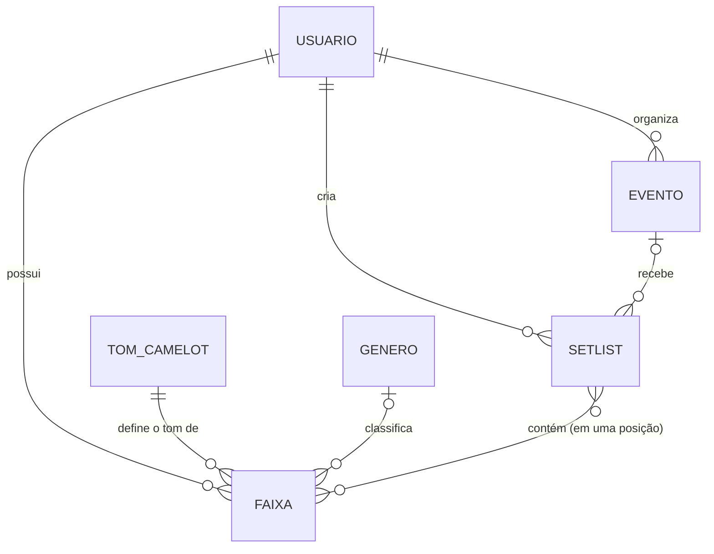
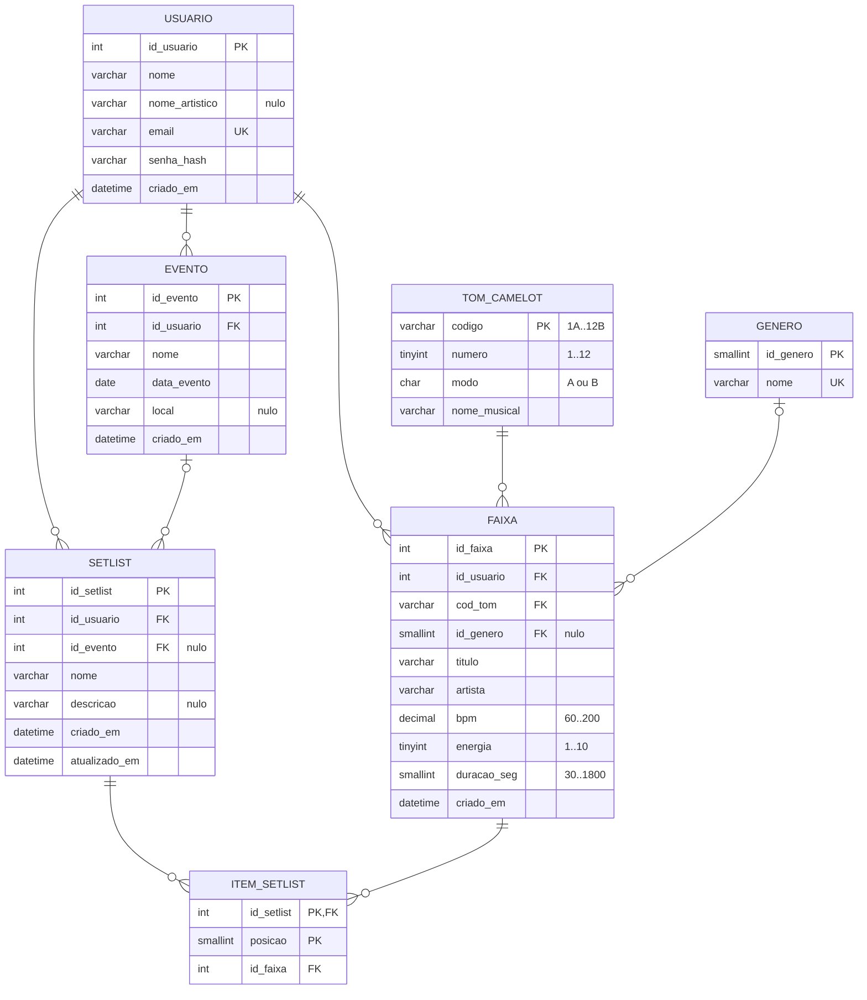

# 4. Projeto de Banco de Dados: HarmoniMix

> Do diagrama de classes de persistência ([03-modelagem-uml.md §3.2](03-modelagem-uml.md#32-diagrama-de-classes-de-domínio-persistência))
> ao banco físico em **MySQL 8**. Documento de Planejamento: versão 2.0.

---

## 4.1 Escolha do SGBD

| Critério | MySQL 8 |
|----------|---------|
| Popularidade | Um dos SGBDs relacionais mais usados no mundo (DB-Engines) |
| Custo | Gratuito (Community Edition), com código aberto |
| Manutenção | Ferramentas maduras (MySQL Workbench, phpMyAdmin, DBeaver) |
| Hospedagem | Oferecido por praticamente todos os provedores de nuvem e hospedagens |
| Recursos usados | InnoDB (transações e FKs), `CHECK` constraints (8.0.16+), `utf8mb4`, views, funções de janela |
| Compatibilidade | O mesmo script roda no **MariaDB 10.5+** (fork compatível) |

Nos **testes automatizados** (Situação 2) usamos **SQLite** em memória, por meio do ORM SQLAlchemy. Assim os testes
rodam rápido, sem precisar de um servidor de banco.

---

## 4.2 Projeto Conceitual (Modelo Entidade-Relacionamento)

Neste nível se representam **o que** será armazenado, sem detalhes de implementação.



**Cardinalidades:**

| Relacionamento | Cardinalidade | Leitura |
|----------------|:-------------:|---------|
| Usuário possui Faixa | 1 : N | Um usuário possui zero ou muitas faixas; cada faixa pertence a exatamente um usuário |
| Usuário organiza Evento | 1 : N | Idem |
| Usuário cria Setlist | 1 : N | Idem |
| Tom define Faixa | 1 : N | Toda faixa tem exatamente um tom; um tom pode estar em várias faixas |
| Gênero classifica Faixa | 0..1 : N | A faixa pode não ter gênero |
| Evento recebe Setlist | 0..1 : N | O setlist pode não estar vinculado a evento |
| **Setlist contém Faixa** | **N : N** | Um setlist tem várias faixas e uma faixa pode estar em vários setlists, com o atributo **posição** no relacionamento |

---

## 4.3 Projeto Lógico Normalizado

### 4.3.1 Ponto de partida: a "planilha do DJ" (não normalizada)

Antes do sistema, o DJ guardava os setlists numa planilha como esta:

| Setlist | Evento | Data | Faixas (título – artista – BPM – tom – nome do tom – gênero) |
|---------|--------|------|---------------------------------------------------------------|
| Warm-up | Formatura | 12/12/2026 | Aurora Boreal – Lumen Drift – 118 – 8A – Lá menor – Deep House; Maré Alta – Coral Sound – 120 – 9A – Mi menor – Deep House; … |

**Problemas (anomalias):**
- **Inserção:** não dá para cadastrar uma música que ainda não está em nenhum setlist.
- **Atualização:** corrigir o BPM de "Maré Alta" exige editar **todas** as linhas onde ela aparece.
- **Exclusão:** apagar o único setlist que contém uma faixa apaga também os dados da faixa.
- **Redundância:** "Lá menor" é repetido para todo 8A; os dados do evento se repetem em cada setlist.

### 4.3.2 Primeira Forma Normal (1FN): atributos atômicos, sem grupos repetitivos

O campo "Faixas" é **multivalorado**, então separamos uma linha por faixa do setlist:

**SETLIST_FAIXA** (<u>setlist</u>, <u>posicao</u>, evento, data_evento, titulo, artista, bpm, cod_tom, nome_tom, genero)

Chave primária composta: (setlist, posicao).

### 4.3.3 Segunda Forma Normal (2FN): sem dependências parciais da chave

Na tabela acima:
- `evento` e `data_evento` dependem **só de `setlist`**, que é parte da chave → **dependência parcial**.
- `titulo, artista, bpm, cod_tom…` dependem da **faixa**, não da posição no setlist.

Decompomos em:
- **SETLIST** (<u>id_setlist</u>, nome, evento, data_evento)
- **FAIXA** (<u>id_faixa</u>, titulo, artista, bpm, cod_tom, nome_tom, genero)
- **ITEM_SETLIST** (<u>id_setlist</u>, <u>posicao</u>, id_faixa)

### 4.3.4 Terceira Forma Normal (3FN): sem dependências transitivas

- Em **FAIXA**: `id_faixa → cod_tom → nome_tom`. O nome do tom depende do código, não da faixa → **transitiva**.
  ➜ criamos **TOM_CAMELOT** (<u>codigo</u>, numero, modo, nome_musical).
- Em **FAIXA**: `genero` era texto livre ("house", "House", "HOUSE"…), o que gera inconsistência.
  ➜ criamos **GENERO** (<u>id_genero</u>, nome), e a faixa passa a guardar `id_genero`.
- Em **SETLIST**: `id_setlist → evento → data_evento` → **transitiva**.
  ➜ criamos **EVENTO** (<u>id_evento</u>, nome, data_evento, local).
- Por fim, o sistema é multiusuário: acrescentamos **USUARIO** e a FK `id_usuario` em FAIXA, EVENTO e SETLIST.

### 4.3.5 Esquema lógico final (3FN)

> <u>sublinhado</u> = chave primária · *itálico* = chave estrangeira

- **USUARIO** (<u>id_usuario</u>, nome, nome_artistico, email, senha_hash, criado_em)
- **TOM_CAMELOT** (<u>codigo</u>, numero, modo, nome_musical)
- **GENERO** (<u>id_genero</u>, nome)
- **FAIXA** (<u>id_faixa</u>, *id_usuario*, *cod_tom*, *id_genero*, titulo, artista, bpm, energia, duracao_seg, criado_em)
- **EVENTO** (<u>id_evento</u>, *id_usuario*, nome, data_evento, local, criado_em)
- **SETLIST** (<u>id_setlist</u>, *id_usuario*, *id_evento*, nome, descricao, criado_em, atualizado_em)
- **ITEM_SETLIST** (<u>*id_setlist*</u>, <u>posicao</u>, *id_faixa*)

**Observação de projeto:** `SETLIST.id_usuario` é mantido mesmo quando há um evento, porque o evento é **opcional**.
Sem esse campo, um setlist sem evento ficaria sem dono. Para evitar inconsistência (setlist de um usuário vinculado a um
evento de outro), a aplicação aplica a **RN15**.

### 4.3.6 Modelo lógico (diagrama com atributos e chaves)



---

## 4.4 Projeto Físico

O script completo está em [`sql/01_schema_mysql.sql`](sql/01_schema_mysql.sql). Os dados iniciais estão em
[`sql/02_dados_iniciais.sql`](sql/02_dados_iniciais.sql) e as consultas de exemplo em [`sql/03_consultas_exemplo.sql`](sql/03_consultas_exemplo.sql).

### 4.4.1 Decisões físicas

| Decisão | Justificativa |
|---------|---------------|
| Engine **InnoDB** | Suporta transações e chaves estrangeiras |
| Charset **utf8mb4** | Acentos (Pôr do Sol), símbolos musicais (♭, ♯) e emojis |
| `DECIMAL(5,2)` para BPM | Valores exatos (ex.: 123.50); `FLOAT` teria erros de arredondamento |
| `duracao_seg` inteiro | Facilita somar a duração total; a tela converte para mm:ss |
| `tom_camelot.codigo` como PK natural | O código (8A) é estável, curto e significativo |
| `tom_camelot.numero` como `TINYINT` com sinal | Permite calcular `numero₁ − numero₂` sem estouro (ver revisão R07) |
| PK composta `(id_setlist, posicao)` em `item_setlist` | A posição identifica o item dentro do set |
| `UNIQUE (id_setlist, id_faixa)` | Garante a RN10 (sem faixa repetida) no próprio banco |
| Índices `(id_usuario, bpm)` e `(id_usuario, cod_tom)` | Aceleram filtros e o cálculo de sugestões (RNF07) |
| Visão `vw_setlist_resumo` | Totais (qtd. de faixas, duração, BPM médio) para o painel |

### 4.4.2 Integridade referencial (ações das FKs)

| FK | ON DELETE | Regra atendida |
|----|-----------|----------------|
| `faixa.id_usuario` → usuario | CASCADE | Excluir a conta remove os dados do usuário |
| `faixa.cod_tom` → tom_camelot | RESTRICT | Não se exclui um tom em uso |
| `faixa.id_genero` → genero | SET NULL | Excluir um gênero não apaga as faixas |
| `setlist.id_evento` → evento | SET NULL | **RN14**: o setlist fica sem evento |
| `item_setlist.id_setlist` → setlist | CASCADE | **RN13**: os itens saem junto com o setlist |
| `item_setlist.id_faixa` → faixa | RESTRICT | **RN12**: faixa em uso não pode ser excluída |

### 4.4.3 Restrições de domínio (CHECK)

Lembrando a teoria: **domínio ≠ tipo de dado**. O tipo `DECIMAL(5,2)` aceita 999,99, mas o **domínio** do BPM é 60–200.

| Restrição | Tipo de dado | Domínio | Regra |
|-----------|--------------|---------|-------|
| `ck_faixa_bpm` | DECIMAL(5,2) | 60,00 a 200,00 | RN02 |
| `fk_faixa_tom` | VARCHAR(3) | {1A, 1B, …, 12B} | RN03 |
| `ck_faixa_energia` | TINYINT | 1 a 10 | RN04 |
| `ck_faixa_duracao` | SMALLINT | 30 a 1800 s | RN04 |
| `ck_tom_numero` / `ck_tom_modo` | TINYINT / CHAR(1) | 1 a 12 / {A, B} | RN03 |
| `ck_item_posicao` | SMALLINT | ≥ 1 | — |
| `ck_usuario_email` | VARCHAR(120) | padrão `x@y.z` | RN01 |

### 4.4.4 Verificação do projeto físico

O script foi executado em **MariaDB 10.11** (compatível com MySQL 8). Cada restrição foi testada com um comando
que **deveria falhar**:

| # | Teste | Resultado esperado | Resultado obtido |
|---|-------|--------------------|------------------|
| 1 | Criar estrutura (`01_schema_mysql.sql`) | Sem erros | ✅ OK |
| 2 | Carga inicial (`02_dados_iniciais.sql`) | 24 tons, 9 gêneros, 18 faixas, 2 setlists | ✅ OK |
| 3 | Faixa com BPM 250 | Rejeitar | ✅ `CONSTRAINT ck_faixa_bpm failed` |
| 4 | Faixa com tom "13C" | Rejeitar | ✅ `foreign key constraint fails (fk_faixa_tom)` |
| 5 | Faixa com energia 11 | Rejeitar | ✅ `CONSTRAINT ck_faixa_energia failed` |
| 6 | Faixa duplicada (título + artista) | Rejeitar | ✅ `Duplicate entry … uq_faixa_usuario_titulo_artista` |
| 7 | Mesma faixa 2× no setlist | Rejeitar | ✅ `Duplicate entry … uq_item_setlist_faixa` |
| 8 | Excluir faixa usada em setlist | Rejeitar | ✅ `Cannot delete … fk_item_faixa` |
| 9 | E-mail duplicado | Rejeitar | ✅ `Duplicate entry … uq_usuario_email` |
| 10 | Excluir evento | Setlists ficam com `id_evento = NULL` | ✅ OK |
| 11 | Excluir setlist | Itens excluídos em cascata | ✅ OK (de 14 para 9 itens) |
| 12 | Consulta de transições (setlist 2) | 7A→8A vizinho (2,48%); 8A→5A incompatível (10,17%); 5A→6A vizinho (7,69%); 6A→9A incompatível (14,29%) | ✅ OK |
| 13 | Sugestões após "Maré Alta" (9A, 120 BPM) | Neon Copacabana (9B, +1,67%) e Batida Urbana (10A, +3,33%) | ✅ OK |

> **Defeito encontrado na verificação:** na primeira versão, `numero` era `TINYINT UNSIGNED`. A consulta de tons
> vizinhos (`numero₁ − numero₂`) gerou o erro `BIGINT UNSIGNED value is out of range`, porque o resultado negativo não
> cabe em um tipo sem sinal. A coluna foi alterada para `TINYINT` com sinal, mantendo o `CHECK (numero BETWEEN 1 AND 12)`.
> Registrado como revisão **R07** em [07-historico-revisoes.md](07-historico-revisoes.md).

### 4.4.5 Como executar

```bash
mysql -u root -p < sql/01_schema_mysql.sql
mysql -u root -p < sql/02_dados_iniciais.sql
mysql -u root -p -t < sql/03_consultas_exemplo.sql
```

O dicionário de dados completo está em [05-dicionario-de-dados.md](05-dicionario-de-dados.md).
