# 6. Interface Humano-Computador (IHC) e Protótipo: HarmoniMix

> Documento de Planejamento: versão 2.0.
> **Protótipo navegável:** [`prototipo/index.html`](prototipo/index.html). Abra no navegador e use a barra preta do topo para trocar de tela.

---

## 6.1 Público-alvo e decisões de design

| Característica do usuário (persona Lucas) | Decisão de interface |
|---|---|
| Não domina teoria musical | Linguagem simples ("vizinho", "relativo", "Suave"/"Arriscada") e página de ajuda com a Roda de Camelot |
| Trabalha à noite, em ambientes escuros | **Tema escuro** com cores de destaque neon (roxo e ciano), padrão de softwares de DJ |
| Pensa nas músicas pelo tom e pelo BPM | Tom exibido como **etiqueta colorida** (cada número da roda tem uma cor) e BPM sempre ao lado |
| Prepara o set no notebook, mas confere no celular | Layout **responsivo**: o menu lateral vira barra superior e os cartões empilham |

## 6.2 Mapa de navegação (arquitetura da informação)

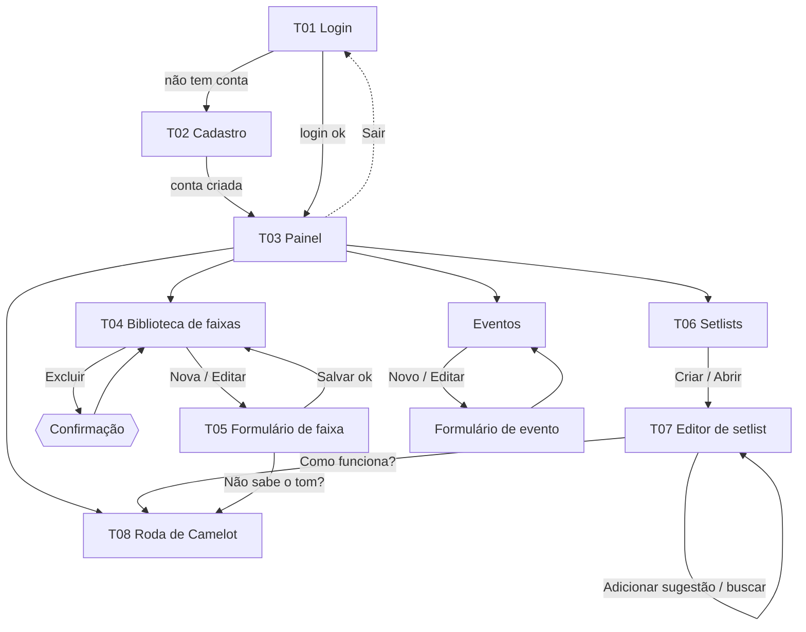

**Menu principal (sempre visível):** Painel · Biblioteca · Setlists · Eventos · Roda de Camelot · Sair.
Toda tela mostra também a **trilha de navegação** (*breadcrumb*), por exemplo "Início › Setlists › Rascunho".

## 6.3 Mapa conceitual do sistema

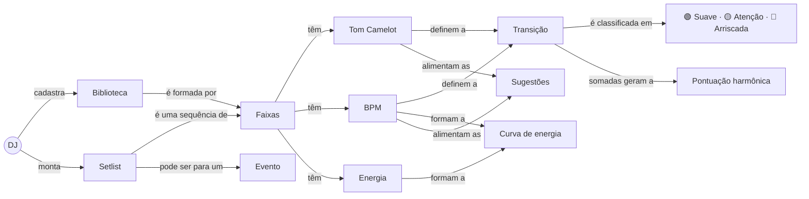

## 6.4 Telas do protótipo

| Tela | Objetivo | Requisitos |
|------|----------|------------|
| T01 Login | Autenticar o DJ | RF02 |
| T02 Cadastro | Criar conta, com validação de senha | RF01, RN01 |
| T03 Painel | Visão geral: totais, setlists recentes e próximos eventos | RF15 |
| T04 Biblioteca | Listar, buscar e filtrar faixas | RF03, RF04 |
| T05 Formulário de faixa | Cadastrar/editar faixa, com validação por campo | RF03, RN02–RN05 |
| T06 Setlists | Listar e criar setlists | RF06 |
| T07 Editor de setlist | Montar o set: transições, sugestões, curva de energia | RF07–RF13 |
| T08 Roda de Camelot | Ajuda interativa sobre compatibilidade | RF14 |

### T01: Login (com mensagem de erro)
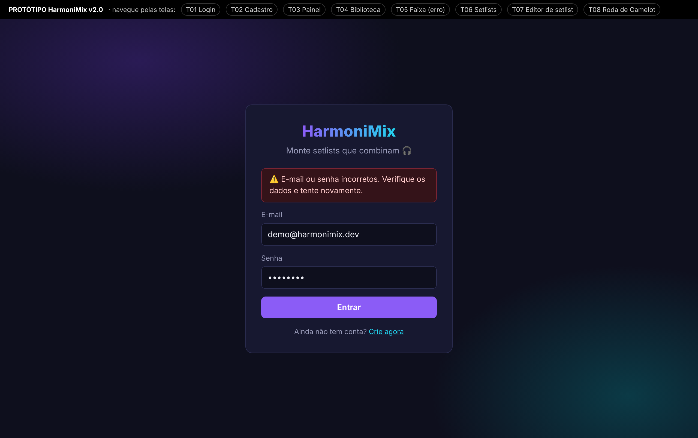

### T02: Cadastro (validação de senha)
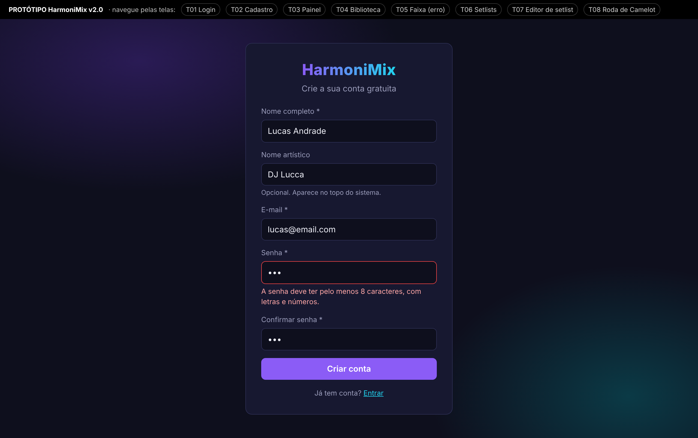

### T03: Painel
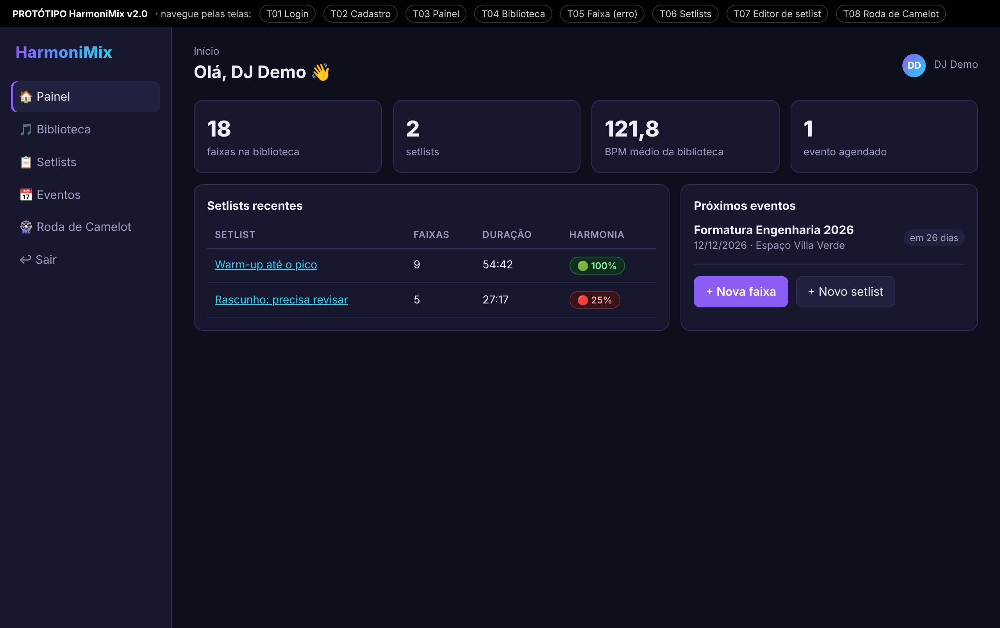

### T04: Biblioteca de faixas (com mensagem de sucesso e filtros)
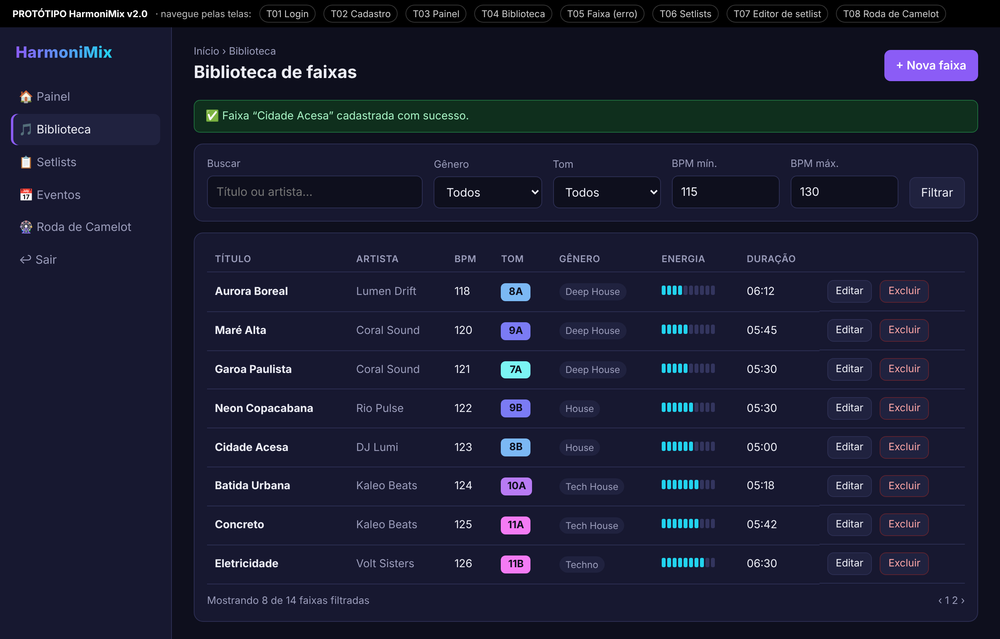

### T05: Formulário de faixa (estado de erro)
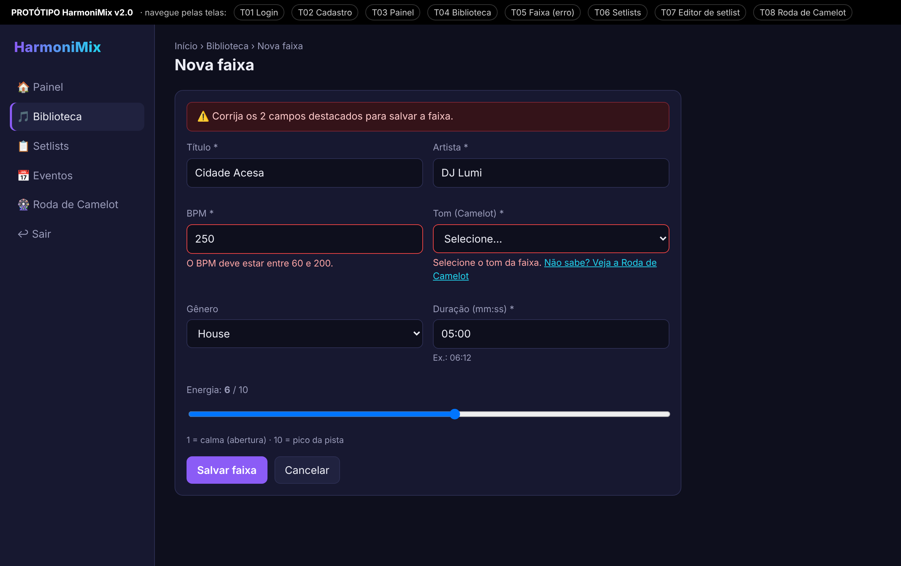

### T06: Setlists
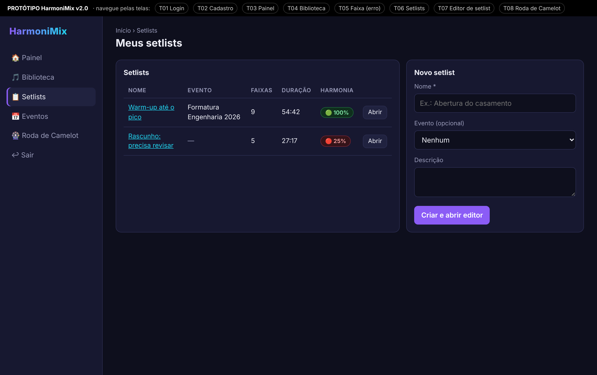

### T07: Editor de setlist (tela principal do sistema)
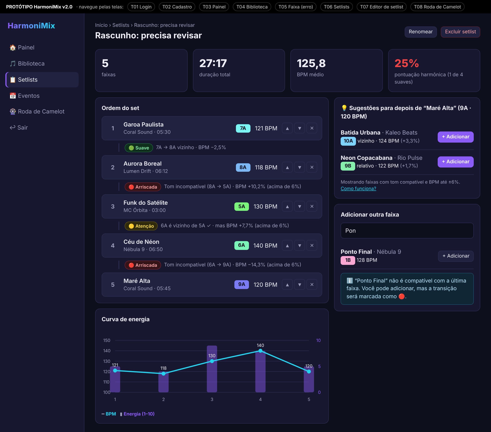

**Versão celular (390 px):**

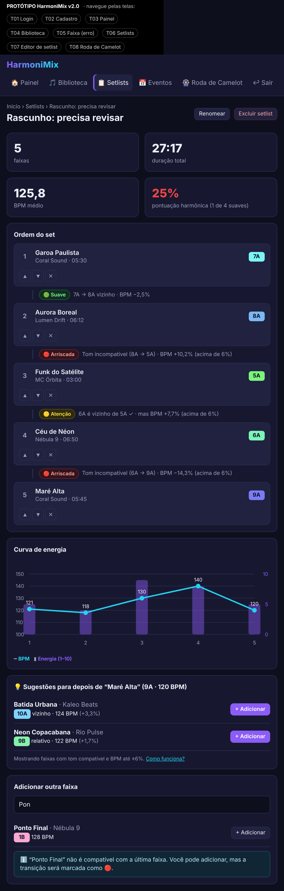

### T08: Roda de Camelot (ajuda interativa)
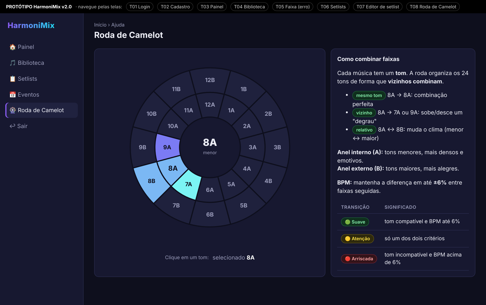

---

## 6.5 Catálogo de mensagens

Toda mensagem diz **o que aconteceu** e, quando é erro, **como resolver** ("boa mensagem, bom tratamento").

| Código | Tipo | Situação | Texto |
|--------|------|----------|-------|
| MSG01 | ❌ Erro | Login inválido | "E-mail ou senha incorretos. Verifique os dados e tente novamente." |
| MSG02 | ❌ Erro | E-mail já cadastrado | "Este e-mail já está em uso. Faça login ou use outro e-mail." |
| MSG03 | ❌ Erro | Senha fraca | "A senha deve ter pelo menos 8 caracteres, com letras e números." |
| MSG04 | ❌ Erro | Campo obrigatório vazio | "Preencha o campo {campo}." |
| MSG05 | ❌ Erro | BPM inválido | "O BPM deve estar entre 60 e 200." |
| MSG06 | ❌ Erro | Tom não informado/inválido | "Selecione o tom da faixa. Não sabe? Veja a Roda de Camelot." |
| MSG07 | ❌ Erro | Duração inválida | "Informe a duração no formato mm:ss (entre 00:30 e 30:00)." |
| MSG08 | ❌ Erro | Faixa duplicada | "Você já cadastrou “{título}” de {artista}." |
| MSG09 | ❌ Erro | Excluir faixa em uso | "Não é possível excluir: esta faixa está nos setlists {lista}. Remova-a deles primeiro." |
| MSG10 | ⚠️ Aviso | Faixa repetida no set | "“{título}” já está neste setlist (posição {n})." |
| MSG11 | ✅ Sucesso | Faixa adicionada | "“{título}” adicionada na posição {n}." |
| MSG12 | ℹ️ Info | Sem sugestões | "Nenhuma faixa da sua biblioteca é compatível com “{título}”. Cadastre mais faixas ou escolha pela busca." |
| MSG13 | ✅ Sucesso | Cadastro/edição salvos | "{Item} salvo com sucesso." |
| MSG14 | ⚠️ Confirmação | Excluir | "Tem certeza que deseja excluir “{nome}”? Esta ação não pode ser desfeita." |
| MSG15 | ℹ️ Info | Faixa incompatível escolhida pela busca | "“{título}” não é compatível com a última faixa. Você pode adicionar, mas a transição será marcada como 🔴." |
| MSG16 | ❌ Erro | Página inexistente / sem permissão | "Página não encontrada. Ela pode ter sido removida ou você não tem acesso." |
| MSG17 | ❌ Erro | Erro inesperado (500) | "Algo deu errado do nosso lado. Tente novamente em instantes." |

## 6.6 Princípios de usabilidade aplicados

| Princípio (material da disciplina / Norman) | Como foi aplicado |
|---|---|
| **Clareza** | Rótulos diretos ("Nova faixa", "Adicionar"); cada transição explica o motivo ("Tom incompatível (8A → 5A)") |
| **Consistência** | Mesmo menu, mesma posição dos botões principais (canto superior direito) e mesmas cores de status em todas as telas |
| **Simplicidade / divulgação progressiva** | A teoria musical fica na página de ajuda; no editor aparecem só os badges e um link "Como funciona?" |
| **Controle do usuário** | O sistema **sugere**, mas não obriga: o DJ pode adicionar uma faixa incompatível (MSG15) |
| **Manipulação direta** | Botões ▲ ▼ ✕ ao lado de cada faixa; a análise e o gráfico se atualizam na hora |
| **Reversível / tolerante a erros** | Confirmação antes de excluir (MSG14); o formulário com erro mantém o que foi digitado |
| **Feedback** | Mensagens de sucesso/erro após cada ação; campos com erro em vermelho e texto explicativo |
| **Visibilidade do estado** | Breadcrumb, item ativo no menu, contadores de faixas, duração e pontuação sempre visíveis |
| **Affordance e mapeamento (Norman)** | Etiquetas de tom com a mesma cor da posição na roda, o que liga a biblioteca à Roda de Camelot |
| **Restrições (Norman)** | Tom escolhido numa lista (não digitado); energia por controle deslizante 1–10; BPM com limites |
| **Acessibilidade** | Status sempre com **ícone + texto + cor** (nunca só cor); contraste alto; `aria-label` no gráfico |
| **Padrões inteligentes** | Energia começa em 5; ao criar um setlist pela tela do evento, o evento já vem selecionado |

## 6.7 Elementos de interface utilizados

| Categoria | Elementos |
|-----------|-----------|
| Controles de entrada | campos de texto, campo numérico (BPM), lista suspensa (tom, gênero, evento), controle deslizante (energia), campo de data (evento), botões |
| Navegação | menu lateral, breadcrumb, campo de busca, paginação, links de ajuda contextual |
| Informativos | badges de status, etiquetas de tom, barras de energia, alertas (sucesso/erro/info), cartões de indicadores, gráfico, janela de confirmação |
| Recipientes | cartões (*cards*), tabelas, grade responsiva |
