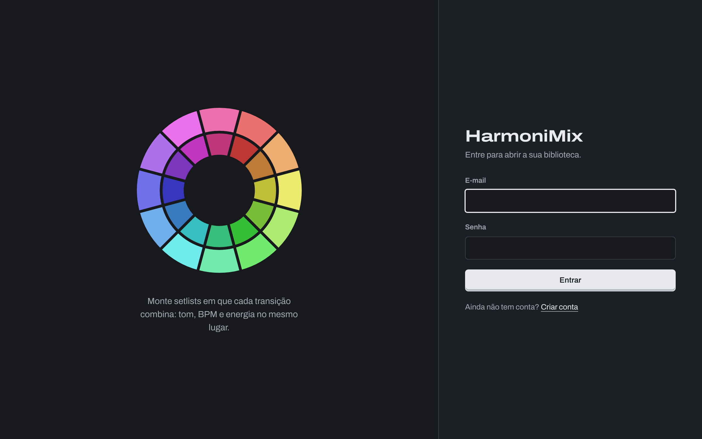
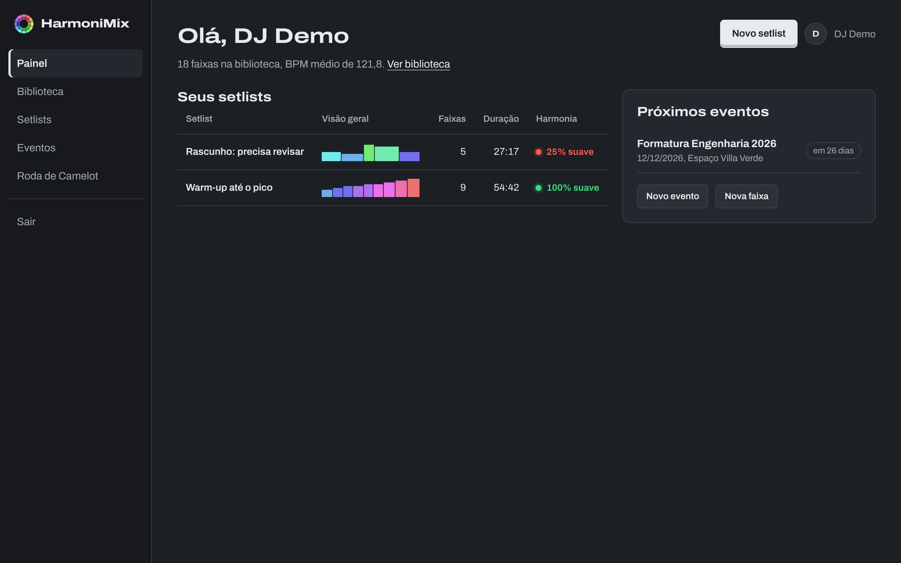
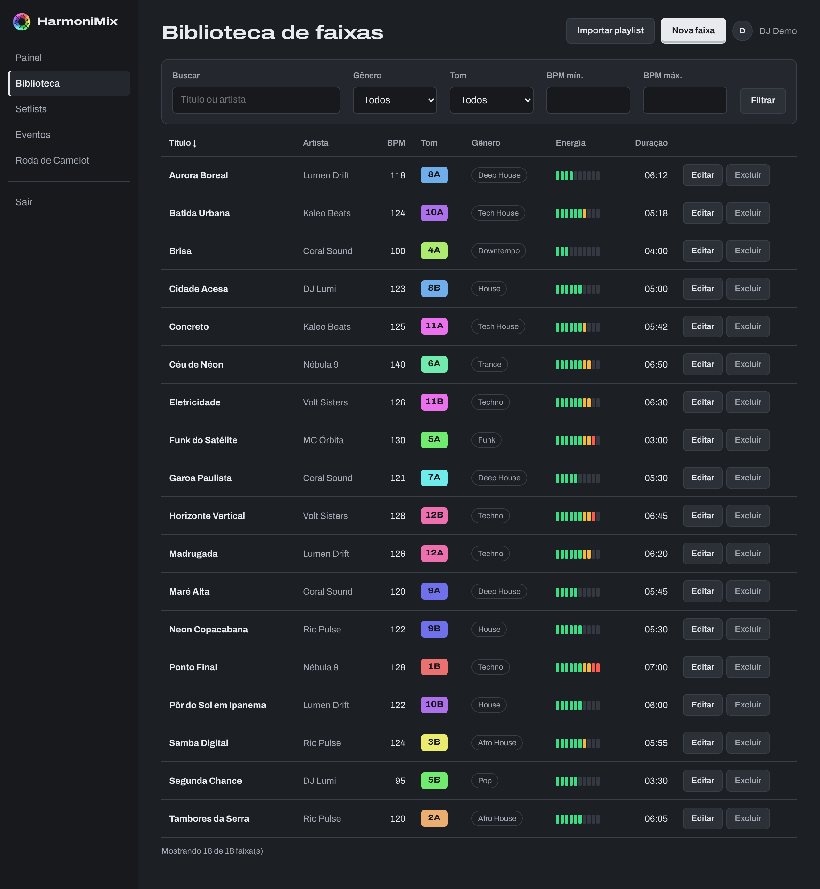
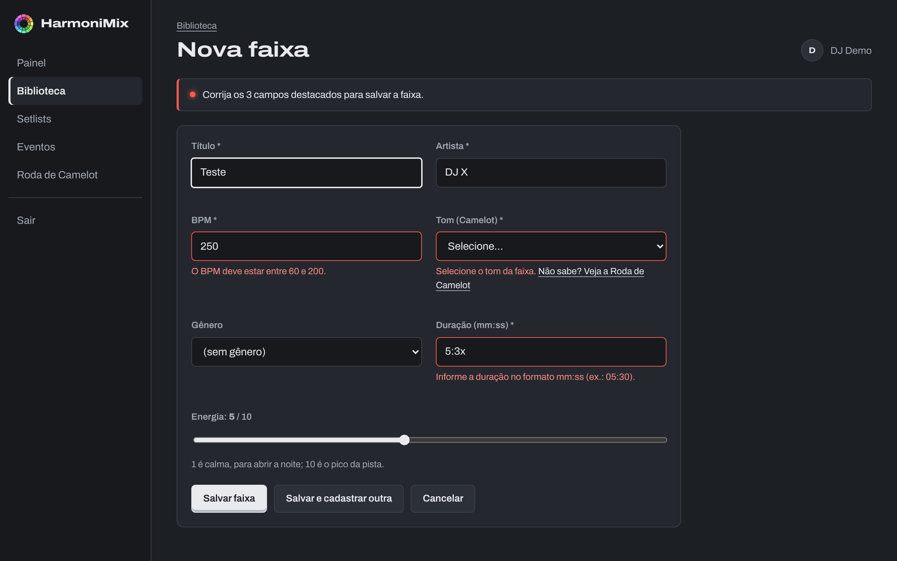
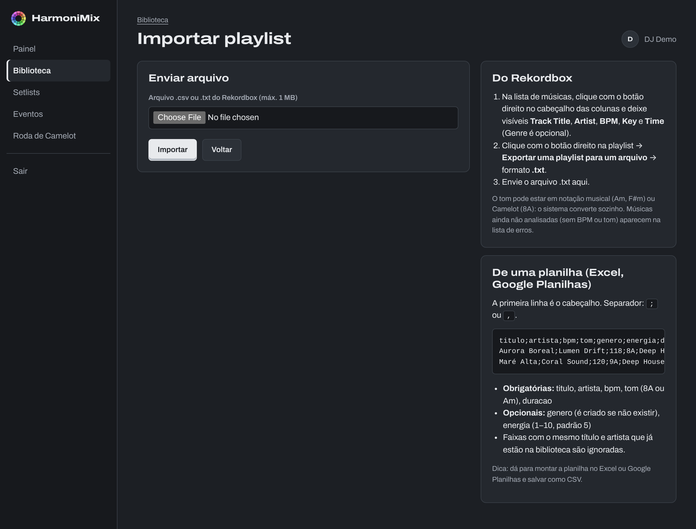
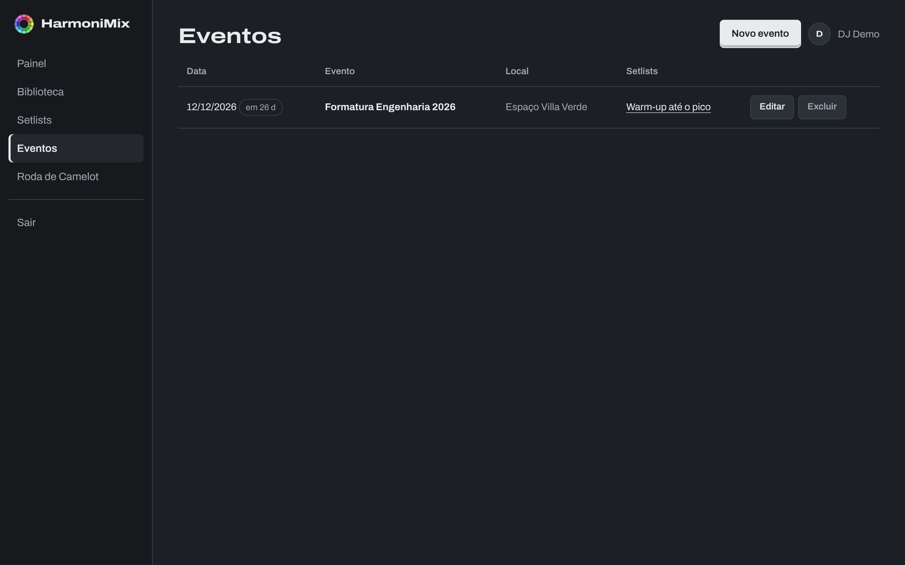
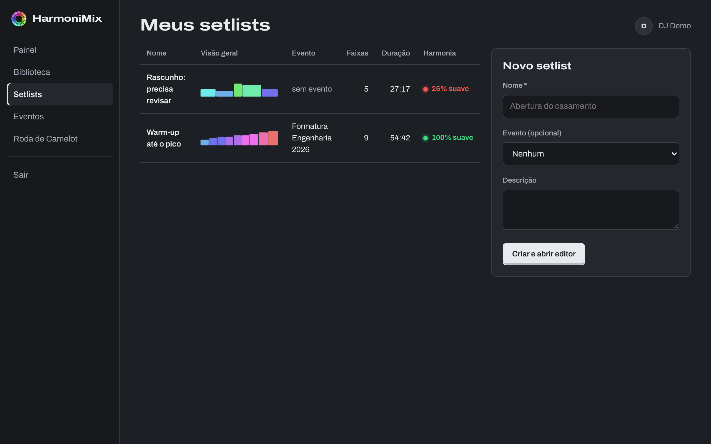
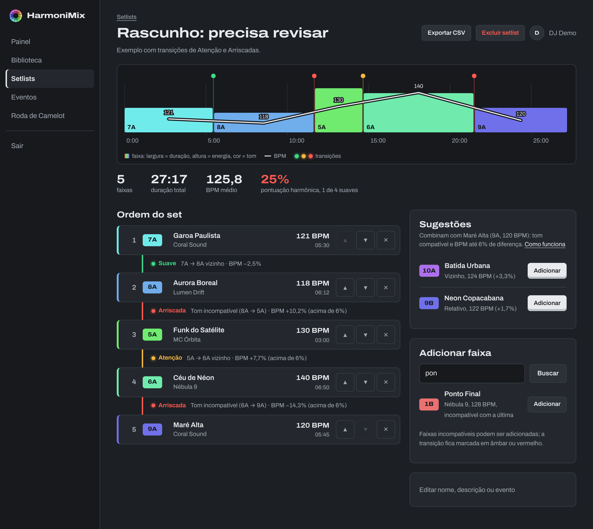
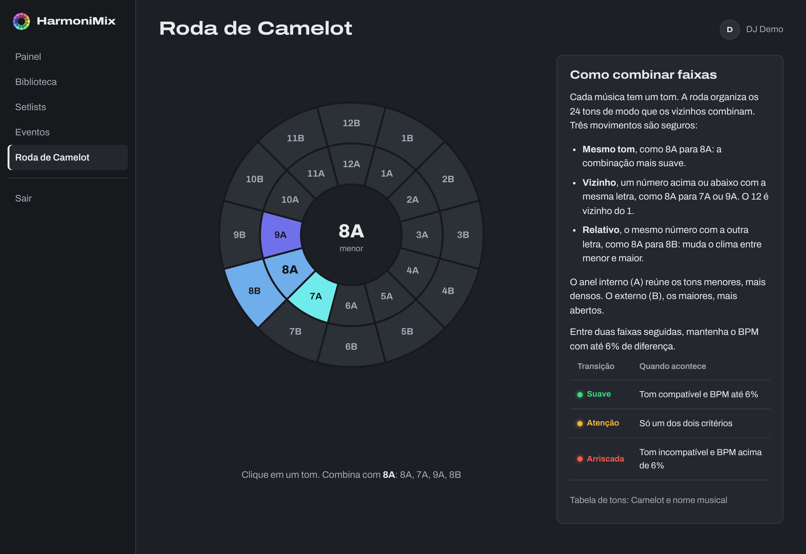
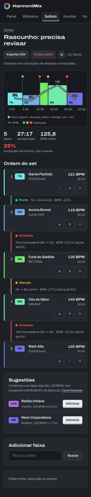

# 📖 Manual de Uso: HarmoniMix

O HarmoniMix ajuda você, DJ, a montar **setlists em que as músicas combinam entre si**. Você cadastra as suas faixas
com **BPM** e **tom**, e o sistema avisa quais transições funcionam e sugere a próxima música.

> **Para testar rápido:** entre com `demo@harmonimix.dev` e senha `Demo1234`. A conta já tem 18 músicas e 2 setlists.

---

## 1. Criar conta e entrar

1. Na tela de login, clique em **Crie agora**.
2. Preencha nome, e-mail e senha (mínimo de 8 caracteres, com letras e números). O nome artístico é opcional.
3. Clique em **Criar conta**. Você já entra direto no painel.

Da próxima vez, use **e-mail e senha** na tela de login. Para sair, clique em **Sair** no menu.



## 2. Painel

Mostra o resumo da sua conta: total de faixas, setlists, BPM médio, setlists recentes (com a nota de harmonia) e os
próximos eventos. Os botões de atalho criam faixas, setlists e eventos.



## 3. Biblioteca de faixas

Menu **Biblioteca**. Aqui ficam todas as suas músicas.

- **Buscar:** digite parte do título ou do artista.
- **Filtrar:** por gênero, tom ou faixa de BPM (ex.: de 120 a 128).
- **Ordenar:** clique no nome da coluna (Título, Artista, BPM, Tom, Energia).
- **Editar / Excluir:** botões em cada linha. Uma faixa que está em algum setlist **não pode ser excluída**; o sistema
  avisa em quais setlists ela está.



### 3.1 Cadastrar uma faixa

Clique em **Nova faixa** e preencha:

| Campo | O que colocar | Exemplo |
|-------|---------------|---------|
| Título e Artista | Nome da música e de quem toca | Aurora Boreal · Lumen Drift |
| BPM | Batidas por minuto (60 a 200) | 118 ou 123,5 |
| Tom (Camelot) | O código da música na Roda de Camelot | 8A |
| Gênero | Opcional | Deep House |
| Duração | Minutos e segundos | 06:12 |
| Energia | De 1 (calma) a 10 (pico da pista) | 4 |

> **Onde descubro o BPM e o tom?** Softwares de DJ (Rekordbox, Serato, Traktor, VirtualDJ) e sites como
> Tunebat ou SongBPM mostram essas informações. Se o tom vier como nome musical (ex.: "Lá menor" ou "Am"), consulte a
> tabela na página **Roda de Camelot**.

Se algo estiver errado, o campo fica **vermelho** com uma explicação, e o que você digitou não se perde.
Use **Salvar e cadastrar outra** para cadastrar várias seguidas.



### 3.2 Importar a sua playlist do Rekordbox (recomendado)

O jeito mais rápido de trazer as suas músicas: o Rekordbox já analisou o BPM, o tom e a duração.

1. No Rekordbox, clique com o botão direito no **cabeçalho das colunas** da lista de músicas e deixe visíveis
   **Track Title**, **Artist**, **BPM**, **Key** e **Time** (e **Genre**, se quiser).
2. Clique com o botão direito na **playlist** → **Exportar uma playlist para um arquivo** → escolha o formato **.txt**.
   (O nome do menu pode variar um pouco conforme a versão do Rekordbox.)
3. No HarmoniMix, vá em **Biblioteca → Importar playlist** e envie o arquivo `.txt`.

O tom pode estar em notação musical (`Am`, `F#m`, `Db`) ou em Camelot (`8A`): o sistema converte sozinho para a Roda
de Camelot. Músicas que o Rekordbox ainda não analisou (sem BPM ou tom) aparecem na lista de erros, com o nome.

### 3.3 Importar de uma planilha (CSV)

Clique em **Importar playlist**. A planilha precisa ter estas colunas na primeira linha:

```
titulo;artista;bpm;tom;genero;energia;duracao
```

`genero` e `energia` são opcionais, e o tom pode ser `8A` ou `Am`. Músicas que já estão na biblioteca são ignoradas,
e as linhas com erro são listadas com o motivo. Há um modelo pronto em [`exemplos/modelo-importacao.csv`](../exemplos/modelo-importacao.csv).

**Dica:** monte a planilha no Excel ou no Google Planilhas e use **Arquivo → Salvar como → CSV**.



## 4. Eventos

Menu **Eventos**. Cadastre as suas apresentações (nome, data e local). Depois, vincule setlists a cada evento.
Se você excluir um evento, os setlists **não são apagados**: só ficam sem evento.



## 5. Setlists

Menu **Setlists**. A lista mostra cada setlist com a quantidade de faixas, a duração e a **nota de harmonia**.
Para criar um, preencha o nome (e o evento, se quiser) e clique em **Criar e abrir editor**.



## 6. Editor de setlist (a parte principal)



### 6.1 Adicionar faixas
- **Sugestões:** depois da primeira música, o sistema mostra as faixas da sua biblioteca que **combinam** com a
  última do set (tom compatível e BPM até ±6%). As melhores aparecem primeiro. Clique em **Adicionar**.
- **Adicionar faixa (busca):** procure qualquer música da biblioteca. Se ela não combinar com a última, aparece a
  etiqueta **incompatível**. Você pode adicionar mesmo assim, pois a decisão é sua.

### 6.2 Ler a análise das transições

No topo do editor, a **visão geral do set** mostra cada música como um bloco (largura = duração, altura = energia, cor = tom), a linha do BPM e um LED colorido em cada transição. Logo abaixo, na ordem do set, cada par de músicas é ligado por uma linha da cor da transição:

| Etiqueta | Significado |
|----------|-------------|
| **Suave** (verde) | Tom compatível **e** BPM até 6% de diferença. A mixagem tende a soar natural. |
| **Atenção** (âmbar) | Só um dos dois critérios foi atendido. Dá para mixar com cuidado (ex.: ajustar o pitch). |
| **Arriscada** (vermelho) | Tom incompatível **e** BPM muito diferente. Melhor reorganizar ou usar uma transição de efeito. |

Ao lado da etiqueta aparece o motivo, por exemplo: *"Tom incompatível (8A → 5A) · BPM +10,2% (acima de 6%)"*.

No topo ficam a **duração total**, o **BPM médio** e a **pontuação harmônica** (percentual de transições suaves).

### 6.3 Reorganizar
- **▲ / ▼** sobem ou descem a música uma posição.
- **✕** remove a música do setlist (ela continua na biblioteca).

### 6.4 Curva de energia
Na visão geral do set, a altura dos blocos é a **energia** e a linha clara é o **BPM**.
Um bom set costuma **começar calmo, crescer e terminar no pico**.

### 6.5 Outras ações
- **Editar nome, descrição ou evento:** no fim da coluna da direita.
- **Exportar CSV:** baixa o setlist com a análise de cada transição (abre no Excel).
- **Excluir setlist:** pede confirmação; as músicas continuam na biblioteca.

## 7. Roda de Camelot (ajuda)

Menu **Roda de Camelot**. Clique em qualquer tom para ver com quais ele combina. As regras são:

- **mesmo tom** (8A → 8A);
- **vizinho**, um número para cima ou para baixo com a mesma letra (8A → 7A ou 9A; o 12 é vizinho do 1);
- **relativo**, mesmo número com a outra letra (8A ↔ 8B).



## 8. No celular

O sistema se adapta à tela do celular: o menu vai para o topo e os blocos ficam um embaixo do outro.



## 9. Mensagens de erro comuns

| Mensagem | O que fazer |
|----------|-------------|
| "E-mail ou senha incorretos" | Confira os dados. A senha diferencia maiúsculas de minúsculas. |
| "O BPM deve estar entre 60 e 200" | Corrija o BPM. Se a música tem 70 BPM, mas você a toca em "double time", cadastre 140. |
| "Informe a duração no formato mm:ss" | Use dois pontos: 05:30. |
| "Você já cadastrou … de …" | Essa música (mesmo título e artista) já está na biblioteca. |
| "Não é possível excluir: esta faixa está nos setlists…" | Remova a faixa desses setlists primeiro. |
| "… já está neste setlist (posição N)" | Uma música não pode se repetir no mesmo set. |
| "Página não encontrada" | O item foi excluído ou pertence a outra conta. |
| "Formulário expirado" | A página ficou aberta muito tempo. Recarregue e tente de novo. |
