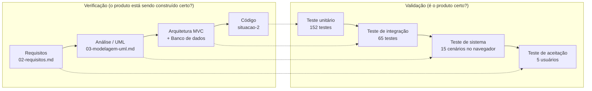

# 🧪 Plano e Relatório de Testes: HarmoniMix

> Situação 3: verificação e validação da solução, documentando que o comportamento esperado foi realizado.

## 1. Objetivo

Demonstrar que o HarmoniMix:
- foi construído **corretamente**, de acordo com a especificação (**verificação**);
- é o produto **certo** para o usuário, que consegue realizar as suas tarefas (**validação**).

## 2. Estratégia: Modelo V



| Nível | Base de comparação | Como | Onde | Quem |
|-------|--------------------|------|------|------|
| **Unitário** | Regras de negócio (RN01–RN15) | pytest, sem banco nem servidor | `situacao-2-desenvolvimento/tests/test_harmonia.py`, `test_validacao.py` | Automatizado |
| **Integração** | Casos de uso e arquitetura | pytest + cliente HTTP do Flask + banco (SQLite e MariaDB) | `situacao-2-desenvolvimento/tests/test_*.py` | Automatizado |
| **Sistema** | Fluxos completos (casos de uso + RNF) | **Playwright: navegador Chromium real** + servidor real com CSRF ligado | [`testes-sistema/`](testes-sistema/) | Automatizado |
| **Aceitação** | Necessidades do usuário | 5 colegas usam o sistema publicado e preenchem o formulário | [VALIDACAO-COM-USUARIOS.md](VALIDACAO-COM-USUARIOS.md) | Pessoas |

Além dos testes, a **verificação estática** (revisões e inspeções) está documentada em [VERIFICACAO.md](VERIFICACAO.md).

## 3. Ambiente de teste

| Item | Configuração |
|------|--------------|
| Sistema operacional | Linux (container) e Windows/macOS dos testadores |
| Python | 3.13 |
| Bancos | SQLite 3 (testes) · MariaDB 10.11, compatível com MySQL 8 (testes e banco da Situação 1) |
| Navegador (sistema) | Chromium (Playwright 1.65), telas 1280×800 e 360×740 (celular) |
| Navegadores (aceitação) | Os dos testadores (Chrome, Edge, Firefox, Safari, celular) |
| Dados | Usuário de demonstração (`seed-demo`) + contas novas criadas pelos próprios testes |

## 4. Critérios

| Critério | Definição |
|----------|-----------|
| **Entrada** | Código da Situação 2 completo; testes unitários e de integração passando |
| **Aprovação de um caso** | Resultado obtido igual ao esperado, sem erros de JavaScript no console |
| **Saída (pronto para entrega)** | 100% dos testes automatizados passando; nenhum defeito de gravidade **A** (impede o uso) em aberto após o teste com usuários; defeitos M/B corrigidos ou justificados |

## 5. Casos de teste de sistema (CTS)

Executados automaticamente em [`testes-sistema/test_sistema.py`](testes-sistema/test_sistema.py). A cada execução, o print
final de cada caso é salvo em [`evidencias/`](evidencias/).

| ID | Requisitos | Cenário (passos resumidos) | Resultado esperado | Resultado | Evidência |
|----|-----------|----------------------------|--------------------|:---------:|-----------|
| CTS-01 | RF01, RF02, RNF01 | Criar conta → sair → acessar `/painel` sem login → login com senha errada → login correto | Conta criada e logada; rota protegida volta para o login; "E-mail ou senha incorretos"; login correto abre o painel | ✅ | [print](evidencias/CTS-01-cadastro-login-logout.png) |
| CTS-02 | RF03, RN02, RN04, RNF04 | Nova faixa com BPM 250 e duração "6:1x" → corrigir → salvar | "Corrija os 3 campos destacados"; mensagem ao lado do BPM; título digitado preservado; controle de energia atualiza o número; faixa salva aparece na lista com 118 / 8A / 06:12 | ✅ | [print](evidencias/CTS-02-validacao-formulario-faixa.png) |
| CTS-03 | RF04 | Filtrar BPM 120–124 + tom 9A → limpar → buscar "lumen" → ordenar por BPM | 1 resultado (Maré Alta); 3 resultados para "lumen"; BPMs em ordem crescente | ✅ | [print](evidencias/CTS-03-busca-e-filtros.png) |
| CTS-04 | RF16 | Importar `modelo-importacao.csv` pela tela | "3 faixa(s) importada(s) com sucesso"; 3 linhas na biblioteca | ✅ | [print](evidencias/CTS-04-importar-csv.png) |
| CTS-05 | RF05, RF06, RN15 | Cadastrar evento → criar setlist vinculado a ele | Evento listado com a data; editor do setlist aberto e vazio | ✅ | (incluído no CTS-06) |
| CTS-06 | RF07, RF09, RF10, RF11, RF13, RN11 | Adicionar 1ª faixa pela busca e as demais pelas 💡 Sugestões | Sugestões só com faixas compatíveis (Funk 5A não aparece depois de 7A); "7A → 8A vizinho · BPM −2,5%"; pontuação 100%; duração 15:00 | ✅ | [print](evidencias/CTS-06-montar-setlist-com-sugestoes.png) |
| CTS-07 | RF08, RF10 | Set Aurora → Funk → Maré (🔴) → descer Funk → remover Funk | Ordem vira Aurora, Maré, Funk; 1ª transição passa a 🟢; botão "subir" desabilitado na 1ª faixa; após remover: 2 faixas e 100% | ✅ | [print](evidencias/CTS-07-reordenar-remover.png) |
| CTS-08 | RF12 | Abrir o setlist "Warm-up até o pico" | Gráfico SVG com 9 pontos de BPM, 9 barras de energia e 1 linha; dica "Aurora Boreal · 8A · 118 BPM" | ✅ | [print](evidencias/CTS-08-curva-de-energia.png) |
| CTS-09 | RNF04 (reversível), MSG14 | Excluir faixa → **Cancelar** → excluir → **OK** | Diálogo "Tem certeza que deseja excluir…?"; ao cancelar nada muda; ao confirmar a faixa é excluída | ✅ | [print](evidencias/CTS-09-confirmacao-exclusao.png) |
| CTS-10 | RN12, MSG09 | Excluir "Maré Alta" (usada em 2 setlists) | Bloqueado: "Não é possível excluir… “Rascunho: precisa revisar”, “Warm-up até o pico”" | ✅ | [print](evidencias/CTS-10-faixa-em-uso-nao-exclui.png) |
| CTS-11 | RF17 | Exportar CSV do setlist "Rascunho" | Download `rascunho--precisa-revisar.csv`; 5 faixas na ordem; coluna de transição: Suave, Arriscada, Atenção, Arriscada | ✅ | [print](evidencias/CTS-11-exportar-csv.png) |
| CTS-12 | RF14 | Abrir a Roda de Camelot → clicar em 12B | 24 tons clicáveis; "Combina com 12B: 12B, 11B, 1B, 12A" (12 vizinho de 1) | ✅ | [print](evidencias/CTS-12-roda-de-camelot.png) |
| CTS-13 | RNF05 | Abrir 10 páginas numa tela de **360 px** (celular) | Nenhuma página com rolagem horizontal; menu visível | ✅ *(após correção D06)* | [print](evidencias/CTS-13-celular.png) |
| CTS-14 | RNF02 | Conta nova acessa `/setlists/1` (de outro usuário) | "Página não encontrada"; biblioteca não mostra faixas alheias | ✅ | [print](evidencias/CTS-14-isolamento-entre-usuarios.png) |
| CTS-15 | RNF03 | Cadastrar faixa `` e setlist `<script>…</script>`; abrir o editor e o gráfico | Nenhum `alert` executado; textos exibidos literalmente | ✅ | [print](evidencias/CTS-15-xss.png) |
| CTS-16 | RNF06 | Verificar 5 telas com formulários; ler as etiquetas de transição | Todo campo tem rótulo (`<label>` ou `aria-label`); toda etiqueta de cor tem texto | ✅ | [print](evidencias/CTS-16-acessibilidade.png) |

**Todos os casos verificam também que não houve nenhum erro de JavaScript na página.**

### Resultado da execução

```
test_sistema.py::test_cts01_cadastro_login_e_logout PASSED
test_sistema.py::test_cts02_validacao_do_formulario_de_faixa PASSED
...
test_sistema.py::test_cts16_campos_tem_rotulo_e_status_tem_texto PASSED
============================= 15 passed in 14.59s ==============================
```

## 6. Resumo geral dos testes automatizados

| Suíte | Testes | Resultado | Banco |
|-------|:------:|:---------:|-------|
| Unitários (Situação 2) | 152 | ✅ 152/152 | não usa |
| Integração e segurança (Situação 2) | 65 | ✅ 65/65 | SQLite e MariaDB |
| Sistema no navegador (Situação 3) | 15 | ✅ 15/15 | SQLite |
| **Total** | **232** | **✅ 100%** | Cobertura do código: **99%** |

## 7. Defeitos encontrados nesta etapa

| ID | Defeito | Encontrado por | Gravidade | Correção | Status |
|----|---------|----------------|:---------:|----------|:------:|
| D06 | No celular (360 px), **todas as páginas** tinham rolagem horizontal (até 656 px): a coluna da grade se alargava para caber o menu, que tem rolagem própria | CTS-13 | M | `grid-template-columns: minmax(0,1fr)` e `min-width: 0` nos itens da grade (aplicado também no protótipo) | ✅ Corrigido |
| D07 | Mesmo após a D06, as páginas com tabela ainda rolavam: o texto invisível "Ações" (só para leitores de tela, `position:absolute`) escapava da área rolável da tabela | CTS-13 (ampliado para 10 páginas) | M | `.table-wrap { position: relative }` | ✅ Corrigido |

Os defeitos D01–D05, encontrados na Situação 2, estão em
[situacao-2-desenvolvimento/docs/RELATORIO-TESTES.md](../situacao-2-desenvolvimento/docs/RELATORIO-TESTES.md#5-defeitos-encontrados-pelos-testes-e-corrigidos).
O registro consolidado, incluindo o que vier do teste com usuários, está em
[correcoes/REGISTRO-DE-CORRECOES.md](correcoes/REGISTRO-DE-CORRECOES.md).

> **Lição aprendida:** os testes de integração (HTML gerado pelo servidor) não pegariam a D06 e a D07. Só um navegador
> de verdade, desenhando a página numa tela pequena, revelou o problema. Cada nível do Modelo V encontra defeitos que
> os outros não encontram.

## 8. Como executar

```bash
pip install playwright pytest
```

```bash
playwright install chromium
```

```bash
cd situacao-3-validacao/testes-sistema
```

```bash
python -m pytest
```

Os prints são regravados em `../evidencias/` a cada execução.
